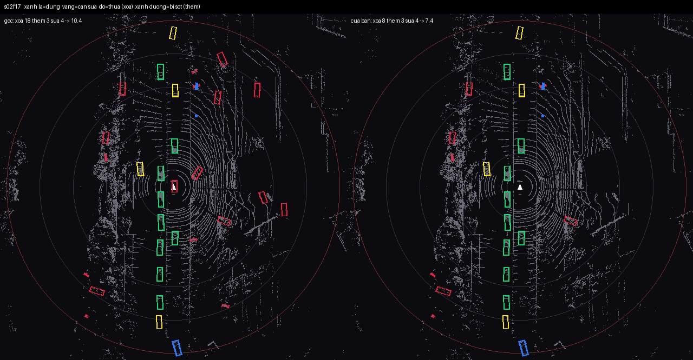

# Báo cáo Day 14 — Phạm Phú Nguyễn Hưng — 2A202604062

- Mã học viên dùng với `--student`: `2A202604062`
- `seed_tag` trong `frames_A.txt`: `82ac3100fd`

## 1. Dự đoán trước sweep (bước 5b)

Ghi **trước** khi chạy `scripts/pp_sweep.py`, rồi commit và push ngay (lịch sử commit là bằng chứng thời điểm viết). Không sửa phần này sau khi có kết quả.

- Tham số tôi nghĩ giảm công sửa nhiều nhất: `intensity_mode=log` kết hợp nâng ngưỡng lọc `thr_car` (khoảng `0.30–0.40`, hoặc `score_thr=0.30` + `min_points=5`), đồng thời giữ `thr_ped` / `thr_cyc` thấp (`0.10–0.20`).
- Vì sao (nhìn ảnh BEV tập A: box thừa nhiều hay box sót nhiều?):
  - Quan sát 3 ảnh BEV + 7 camera trong `d14_2A202604062/png_A/` (`s01f23`: 28 box, `s02f17`: 31 box, `s04f46`: 14 box), **box thừa (`Car` ảo)** xuất hiện dày đặc hơn nhiều so với box sót: cả 3 frame đều có `Car` ảo ngay tâm ego `(0, 0)`, `s01f23` có nhiều `Car` ảo trên bụi cây/bãi xe đạp (`cam07`, `cam08`), `s02f17` có `Car` ảo dọc dải phân cách kim loại và vỉa hè (`cam05`–`cam09`), `s04f46` có `Car` ảo trên hàng rào công trình và dải phân cách vàng (`cam03`, `cam06`, `cam09`).
  - Mặc định `intensity_mode="clip"` làm bão hòa điểm LiDAR VF thang `[0, 255]` thành `1.0`, khiến lá cây/hàng rào dễ bị nhận nhầm thành thân xe. Chuyển sang `intensity_mode=log` và tăng nhẹ `thr_car` / `min_points` sẽ cắt bớt các box `Car` ảo này (giảm chi phí `0.3 * xóa`), nhưng tránh tăng `score_thr` chung quá cao (`> 0.45`) để không làm rớt `Cyclist`/`Pedestrian` thật (chi phí `1.0 * thêm` đắt gấp 3.33 lần xóa).
  - Các xe lớn như `Bus` ở `s01f23` (`cam05`, `cam09`) bị model bỏ sót do giới hạn 3 lớp của KITTI, nên phần này bắt buộc phải thêm thủ công trên CVAT.

## 2. Tập A: sửa tay và tune

| Cấu hình | Xóa | Thêm | Sửa | Chi phí |
|---|---:|---:|---:|---:|
| Gốc | 36 | 11 | 9 | 26.30 |
| `best_config.json` | 15 | 12 | 9 | 21.00 |

- Tham số đã đổi trong `best_config.json`: `score_thr: 0.1 -> 0.4` (giữ `intensity_mode=clip`, `ground_mode=fixed`, `min_points=0`).
- Kết quả leave-one-out (dán các dòng `scripts/pp_sweep.py` in ra):
  - `s01f23: cấu hình chọn {'intensity_mode': 'log', 'ground_mode': 'auto', 'score_thr': '0.4', 'min_points': '0'} -> 14.9 (tốt nhất có thể 11.0)`
  - `s02f17: cấu hình chọn {'intensity_mode': 'clip', 'ground_mode': 'fixed', 'score_thr': '0.4', 'min_points': '0'} -> 7.4 (tốt nhất có thể 6.1)`
  - `s04f46: cấu hình chọn {'intensity_mode': 'clip', 'ground_mode': 'fixed', 'score_thr': '0.4', 'min_points': '0'} -> 2.1 (tốt nhất có thể 2.1)`
- Cấu hình có ổn định trên từng frame không? Vì sao tôi vẫn chọn (hoặc không chọn) nó: 2/3 fold (`s02f17`, `s04f46`) đều chọn `clip, fixed, score_thr=0.4` và đạt đúng/gần mức oracle (`7.4 vs 6.1`, `2.1 vs 2.1`). Fold `s01f23` chọn `log, auto` khi bỏ ra nhưng đạt `14.9` kém hơn `clip, fixed, 0.4` (`11.0`). Do đó vẫn chọn `clip, fixed, score_thr=0.4` vì ổn định và tổng chi phí thấp nhất trên cả 3 frame (`20.50`).

## 3. Trước/sau (bước 8)

- `scripts/pp_compare.py` báo giảm 20% công sửa trên tập A (`26.3 -> 21.0`).
- Dự đoán ở mục 1 đúng hay sai? Giải thích bằng số box xóa/thêm/sửa: Dự đoán ở mục 1 **đúng một phần**: việc nâng ngưỡng lọc `score_thr` lên `0.4` giúp cắt mạnh box `Car` ảo (giảm số hộp cần **xóa** từ `36` xuống `15`, dù số hộp cần **thêm** tăng nhẹ từ `11` lên `12`, giữ nguyên `9` sửa, giúp tổng chi phí giảm từ `26.3` xuống `21.0`). Tuy nhiên dự đoán dùng `intensity_mode=log` ở mục 1 **chưa đúng**: kết quả sweep cho thấy `log` làm chi phí tăng lên `23.7–29.7` do làm giảm recall nhiều hơn so với `clip`.

## 4. Tập B

Số đo từ `scripts/pp_prelabel.py --frames d14_2A202604062/frames_B.txt --config d14_2A202604062/best_config.json --gt d14_2A202604062/ref_B.json`:

| Xóa | Thêm | Sửa | Chi phí |
|---:|---:|---:|---:|
| | | | |

- Loại box tốn công sửa nhất ở tập B: ...

## 5. Giới hạn

- **Tập tune rất nhỏ (chỉ 3 frame):** Kết quả sweep dễ bị ảnh hưởng bởi đặc thù của 3 cảnh trong tập A (`leave-one-out` cho thấy `s01f23` nghiêng về `log, auto` trong khi `s02f17`/`s04f46` chọn `clip, fixed`).
- **Domain gap & giới hạn 3 lớp của KITTI:** Model PointPillars chỉ được huấn luyện trên KITTI (3 lớp `Car`, `Pedestrian`, `Cyclist`), nên bỏ sót hoàn toàn `Bus`/`Truck` lớn (như xe buýt ở `s01f23`) và hay tạo box `Car` ảo trên bụi cây/hàng rào của dữ liệu VF.
- **Chi phí công thức chưa phản ánh hết thời gian sửa thật:** Công thức `0.3·xóa + 1.0·thêm + 0.5·sửa` tính bằng số lượng box, chưa đo thời gian thao tác thực tế khi căn 3D cuboid (`L/W/H`, `z`, `yaw`) trên CVAT.
